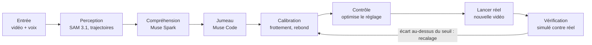

# RealityLoop — Fiche projet

Meta Global AI Developer Hackathon · fiche du 28 octobre 2026

RealityLoop est un agent qui filme un système physique simple, construit son jumeau numérique calibré, prédit un résultat, puis le vérifie dans le monde réel et se recale s'il se trompe.

## Résumé

- **Pitch :** réel → simulation → prédiction → action → vérification, en boucle fermée.
- **Problème :** monter un jumeau numérique calibré demande aujourd'hui des semaines à un expert, et l'écart entre simulation et réalité est rarement mesuré.
- **Utilisateurs visés :** ingénieurs en prototypage, laboratoires d'enseignement, clubs de robotique des écoles. À confirmer avec au moins un utilisateur réel dont on cite le retour dans la vidéo.
- **Problem statement :** « Push the Frontier » (comprendre et contrôler un système physique), avec un angle « Build for Your World » si l'utilisateur est un labo de vos écoles.
- **Piste :** Indie Developer ou Startups. La page de l'événement ne précise pas laquelle accepte une équipe de 4 : question à poser dans #questions.
- **Équipe :** 4 étudiants (ENSAE, ENSIMAG, IMT Atlantique, IMT Nord Europe).
- **Projets sources dans l'archive :** SIMUL-AI-TOR (KG-026), LabTwin (CV1-001, 1er prix), IRRS (CV4-009), Etch (CV1-004, circuit routé et vérifié).

## Démo de 3 minutes

La démo raconte une boucle complète, avec un premier essai raté puis corrigé par l'agent. Découpage proposé :

1. **0:00–0:20.** Plan fixe sur une rampe, une bille et un gobelet. Voix off : « On demande à l'agent de la faire tomber dans le gobelet. » Un premier lancer sert de vidéo de référence.
2. **0:20–0:50.** SAM 3.1 masque et suit la bille, la trajectoire se trace à l'écran. Muse Spark décrit la scène (rampe, obstacle, gobelet) et propose la structure du modèle.
3. **0:50–1:20.** Muse Code écrit le simulateur, l'agent ajuste frottement, rebond et masse jusqu'à superposer la simulation à la vidéo. L'erreur s'affiche avec son incertitude.
4. **1:20–1:50.** Commande vocale (Muse Voice Transcribe) : « Mets-la dans le gobelet. » L'agent optimise l'angle dans le jumeau, annonce l'atterrissage prédit avec son incertitude et demande de régler la rampe.
5. **1:50–2:20.** Réglage et lancer réel. Le résultat est celui qu'on obtient, sans mise en scène.
6. **2:20–2:50.** L'agent mesure l'écart, recale son modèle, refait une prédiction. Deuxième lancer, dans le gobelet.
7. **2:50–3:00.** Tableau de résultats sur le banc d'essai, mention du modèle ouvert servi sur Baseten et du dépôt public.

**Point d'honnêteté.** Si le premier lancer réussit, ne simulez pas un échec : perturbez le système (autre surface, autre bille) pour provoquer un vrai écart. La règle du hackathon impose de montrer uniquement ce qui a été construit pendant l'événement.

## Architecture

Chaque modèle Meta a un rôle précis dans la boucle, et la vérification décide seule si l'agent continue ou se recale.

| Étape | Modèle ou outil | Rôle | À vérifier le premier jour |
| --- | --- | --- | --- |
| Entrée | Vidéo de caméra fixe, note vocale (Muse Voice Transcribe) | Fournit la scène et la consigne | Formats vidéo acceptés par l'API |
| Perception | SAM 3.1 | Segmente la bille et les objets, en déduit les trajectoires | Le suivi d'une image à l'autre existe-t-il via l'API ? Sinon : segmentation image par image et suivi maison |
| Compréhension | Muse Spark (version ouverte `meta-models/muse-spark-open-1026` sur Baseten pour le prix Open Weights) | Décrit la scène, propose la structure du modèle physique | Qualité de la lecture de vidéo par la version ouverte |
| Jumeau | Muse Code, moteur de simulation 2D simple | Écrit et exécute le simulateur en bac à sable | Exécution du code généré sans risque |
| Calibration | Optimisation maison | Ajuste frottement, rebond, masse sur la trajectoire observée, avec incertitudes | Choix de la méthode (moindres carrés, bootstrap) |
| Contrôle | Optimisation dans le jumeau | Trouve le réglage (angle de rampe) qui atteint la cible, avec une prédiction chiffrée | Sensibilité du résultat aux paramètres |
| Vérification | Comparaison simulé contre observé | Mesure l'erreur de prédiction, déclenche le recalage si elle dépasse un seuil | Seuil d'acceptation à fixer sur les premières vidéos |
| Interface | Application web | Téléverse une vidéo ou filme en direct, affiche masques, courbes et erreur | — |

## Grille du jury et prix bonus

Le projet vise les quatre critères de la grille, avec l'impact comme point à renforcer. La grille et les montants viennent de la page officielle de l'événement ; la colonne « ce qu'on montre » est notre plan.

| Critère | Poids | Ce qu'on montre | Point faible à corriger |
| --- | --- | --- | --- |
| Impact | 30 % | Un jumeau numérique calibré en quelques minutes au lieu de semaines | Une bille et un gobelet présentent peu d'impact : ajouter un cas réel d'un laboratoire d'école et une citation d'utilisateur |
| Use of Meta AI Tooling | 25 % | SAM 3.1, Muse Spark, Muse Voice Transcribe et Muse Code, chacun indispensable à la boucle | Aller au-delà de l'intégration basique : l'agent corrige son modèle lui-même |
| Demo | 25 % | Premier essai, écart mesuré, recalage, deuxième essai réussi | Fiabilité en direct : garder des prises enregistrées en secours |
| Technical Depth & Execution | 20 % | Identification de paramètres avec incertitudes, banc d'essai chiffré | Documenter la méthode et les limites dans le dépôt |

| Prix bonus | Montant | Ce qu'il faut pour y prétendre |
| --- | --- | --- |
| Most Viral Project | 20 000 $ | Publier la démo sur X et déposer le lien sur la plateforme, engagement compté jusqu'au 8 novembre |
| Best Build on Meta Open Weight Models | 10 000 $ | Servir Muse Glimmer ou Muse Spark Open sur son matériel ou via un partenaire (Baseten, Modal, Fireworks) |
| Community Vote | 10 000 $ | Un vote par compte vérifié dans la galerie publique |
| Best Agentic Use-Case | 5 000 $ | Autonomie, efficacité et utilité pratique de l'agent |
| Best Creative Build | 5 000 $ | Non visé : exige Muse Image ou Muse Wonder |

## Périmètre, plan et rôles

Le projet avance par trois paliers, chacun livrable seul, pour avoir une démo dès le premier. La soumission est due le mercredi 4 novembre à 21h ET, soit le jeudi 5 à 3h à Paris. Les dates ci-dessous sont notre proposition ; le premier palier est déjà serré puisque la période de construction a commencé le 27 octobre.

| Phase | Dates | Contenu | Critère de passage |
| --- | --- | --- | --- |
| Palier 1 | 28–29 octobre | Vidéo → trajectoire → paramètres ajustés → superposition | Erreur de superposition chiffrée |
| Palier 2 | 30 octobre – 1er novembre | Prédiction, contrôle, vérification, recalage | Un cycle complet mesuré puis recalé |
| Palier 3 | 2–3 novembre | Second système, banc d'essai, modèle ouvert | Tableau d'erreurs sur plusieurs vidéos |
| Soumission | 3–4 novembre | Vidéo de 3 minutes, README, post sur X, dépôt | Soumis avant la date limite |

Le palier 1 suffit déjà à produire une démo.

| Rôle | Périmètre | Livrable | Qui |
| --- | --- | --- | --- |
| Perception et API Meta | Appels à SAM 3.1, Muse Spark et Muse Voice Transcribe, extraction des trajectoires | Module perception avec tests | À remplir |
| Simulation et calibration | Moteur 2D, ajustement des paramètres, incertitudes, banc d'essai | Module jumeau et métriques d'erreur | À remplir |
| Agent et contrôle | Boucle propose-code-exécute-évalue, optimisation, vérification et recalage | Orchestrateur de l'agent | À remplir |
| Interface, démo et diffusion | Application web, vidéo de 3 minutes, publication sur X, README, soumission | Application, vidéo et dépôt soigné | À remplir |

Dans l'équipe, une personne est désignée Représentant : c'est elle qui dépose le projet sur la plateforme.

## Risques, règles et soumission

Le risque principal est la fiabilité de la démo physique, suivi de l'impact perçu comme faible. Les capacités des modèles Muse (entrée vidéo, suivi par SAM 3.1, formats) n'ont pas été vérifiées : elles sont à tester le premier jour.

| Risque | Conséquence | Parade |
| --- | --- | --- |
| SAM 3.1 sans suivi vidéo via l'API | Trajectoires à reconstruire | Segmentation image par image et suivi maison, test dès le premier jour |
| Démo physique capricieuse (lumière, cadrage) | Échec en direct | Caméra fixe sur trépied, repère d'échelle sur la table, prises de secours enregistrées |
| Impact jugé faible | Note Impact (30 %) basse | Un cas réel de laboratoire d'école et une citation d'utilisateur dans la vidéo |
| Simulation trop simple pour coller aux vidéos | Erreur de prédiction élevée | Commencer par un cas à réponse connue, afficher l'erreur plutôt que la masquer |
| Version ouverte du modèle moins bonne en vidéo | Prix Open Weights compromis | Ne l'utiliser que sur l'étape où elle suffit, comparer avec la version API |
| Périmètre trop large | Rien de terminé | Trois paliers, chacun livrable seul |

**Règles de la page à respecter**

- Dépôt public, équipe de 4 au maximum.
- Travail réalisé pendant l'événement ; la démo ne montre que ce qui a été construit pendant l'événement, sinon disqualification. Un historique de commits clair en est la preuve.
- Aucun code, donnée ou ressource dont vous n'avez pas les droits.
- Tous les contributeurs listés sur la fiche de soumission, une seule soumission par équipe.
- Vidéo de démo de 3 minutes, dont le lien doit être accessible.

**Checklist**

- [ ] Chaque membre réclame ses 150 $ de crédits Meta avant le 4 novembre, 21h ET (carte bancaire requise)
- [ ] Demander les crédits Baseten (100 $) et Modal (100 $), en nombre limité
- [ ] Poser dans #questions la question de la piste pour une équipe de 4
- [ ] Tester chaque modèle : entrée vidéo, suivi SAM 3.1, modèle ouvert sur Baseten
- [ ] Désigner le Représentant de l'équipe
- [ ] Créer le dépôt public, avec un historique de commits clair
- [ ] Trouver un utilisateur réel et recueillir sa citation
- [ ] Publier la démo sur X et déposer le lien sur la plateforme
- [ ] Vérifier que dépôt et vidéo sont accessibles, et que tous les contributeurs sont listés
- [ ] Soumettre avant le mercredi 4 novembre, 21h ET (jeudi 5 novembre, 3h à Paris)

**Sources :** [page officielle de l'événement](https://cerebralvalley.ai/e/meta-ai-developer-hackathon/details) (règles, grille, prix, crédits) ; étude des gagnants fournie par l'équipe (projets cités KG-026, CV1-001, CV4-009, CV1-004).
